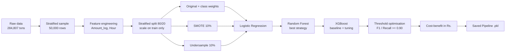

<p align="center">
  
</p>

<p align="center">
  
  
  
  
  
</p>

<p align="center">
  <a href="https://www.kaggle.com/datasets/mlg-ulb/creditcardfraud"></a>
  <a href="FraudDetection_SupervisedLearning.ipynb"></a>
  <a href="summary_report.md"></a>
  <a href="#-video-walkthrough"></a>
  <a href="https://colab.research.google.com/github/YOUR-USERNAME/credit-fraud-detection-supervised-learning/blob/main/FraudDetection_SupervisedLearning.ipynb"></a>
</p>

<p align="center">
  
  
  
  
  
</p>

---

## Table of contents
1. [Project overview](#-project-overview)
2. [Why accuracy fails](#-why-accuracy-fails)
3. [Pipeline at a glance](#-pipeline-at-a-glance)
4. [Dataset](#-dataset)
5. [Exploratory data analysis](#-exploratory-data-analysis)
6. [Handling the imbalance](#-handling-the-imbalance)
7. [Models and results](#-models-and-results)
8. [Threshold optimisation](#-threshold-optimisation)
9. [Business impact](#-business-impact-cost-benefit)
10. [Code explanation (step by step)](#-code-explanation)
11. [Viva questions and answers](#-viva-questions-and-answers)
12. [Video talking points](#-video-talking-points)
13. [Key learnings](#-key-learnings)
14. [Repository structure](#-repository-structure)
15. [Quick start](#-quick-start)
16. [Using the saved model](#-using-the-saved-model)
17. [Video walkthrough](#-video-walkthrough)
18. [Submission checklist](#-submission-checklist)

---

## 🎯 Project overview
You are a junior data scientist on the fraud-analytics team of a digital payments company (think Paytm or Razorpay). Millions of transactions flow through the platform every day and only a tiny fraction are fraudulent, yet each missed fraud costs real money and damages customer trust.

This project builds a complete fraud-detection pipeline that:

- **handles extreme class imbalance** (0.17% fraud) with class weights, SMOTE oversampling and random undersampling, applied to **training data only**
- **compares three model families**: Logistic Regression, Random Forest and a tuned XGBoost
- uses **PR-AUC** (not accuracy, not ROC-AUC) as the primary metric
- **tunes the decision threshold** beyond the default 0.5 (F1-optimal and Recall >= 0.90)
- **converts the confusion matrix into rupees** with a cost-benefit simulation
- **ships a single scikit-learn Pipeline** (`.pkl`) that carries its own decision threshold

## 🚨 Why accuracy fails
If 99.83% of transactions are legitimate, a model that predicts *"Not Fraud"* for everything scores **99.83% accuracy**, yet it catches **0%** of fraud.

On this project's test set the "always legitimate" baseline scores **99.83% accuracy with recall 0.00**.

| Metric | Why it is (not) useful here |
|---|---|
| Accuracy | Rewards predicting the majority class, so it is misleading |
| ROC-AUC | Diluted by the huge pool of true negatives, so it stays near 1.0 |
| **Precision / Recall / F1** | Focus on the fraud class and show the real trade-off |
| **PR-AUC** | Summarises precision vs recall over all thresholds. This is our primary metric |

## 🔧 Pipeline at a glance
<p align="center">
  
</p>



> [!IMPORTANT]
> The **test set is never resampled or modified**. SMOTE and undersampling touch the training data only, and the notebook proves it with a fingerprint check.

## 📂 Dataset
| Item | Detail |
|---|---|
| Source | [Kaggle: Credit Card Fraud Detection (mlg-ulb)](https://www.kaggle.com/datasets/mlg-ulb/creditcardfraud) |
| Rows | 284,807 transactions (a stratified **50,000-row** sample is used locally) |
| Features | 30: `V1`-`V28` (PCA-transformed), `Time`, `Amount` |
| Target | `Class` (1 = fraud, 0 = legitimate) |
| Imbalance | about **0.17%** fraud |

**Engineered features:** `Amount_log = log1p(Amount)` to tame the right skew and `Hour = (Time % 86400) // 3600` for time of day. The original `Time` and `Amount` columns are dropped, and only `Amount_log` and `Hour` are standard-scaled because V1-V28 are already PCA-scaled.

## 🔍 Exploratory data analysis
<p align="center">
  
  
</p>
<p align="center">
  
</p>
<p align="center">
  
</p>

- **Amount:** median fraud amount is Rs.11.85 vs Rs.22.00 for legitimate transactions.
- **Time:** 26% of fraud happens between 00:00 and 05:59 against 9% of legitimate traffic.

## ⚖️ Handling the imbalance
| Strategy | What it does | Pros | Cons |
|---|---|---|---|
| **Class weights** | Fraud errors count more in the loss | No data change, no leakage | Adds no new information |
| **SMOTE** (fraud to 10% of legit) | Synthesises new fraud points | Keeps all data | Synthetic points can be unrealistic |
| **Random undersampling** (10%) | Drops legitimate rows | Fast, focuses on fraud | Throws away information |

Best strategy for Logistic Regression (by PR-AUC): **SMOTE**.

## 🤖 Models and results
**Logistic Regression: three variants**

| Variant | Precision | Recall | F1 | PR-AUC |
|---|:---:|:---:|:---:|:---:|
| LR | Original | 0.041 | 0.824 | 0.079 | 0.594 |
| LR | SMOTE | 0.462 | 0.706 | 0.558 | 0.610 |
| LR | Undersampled | 0.129 | 0.765 | 0.220 | 0.550 |

**Random Forest** used the **SMOTE** training set with `class_weight='balanced'`. **XGBoost** used `scale_pos_weight = 578.7`, then `RandomizedSearchCV` (15 iterations, 3-fold CV, scoring on average precision). Best parameters: `{'subsample': 0.8, 'n_estimators': 300, 'max_depth': 4, 'learning_rate': 0.1, 'colsample_bytree': 0.8}`, best CV PR-AUC **0.845**.

<p align="center">
  
</p>

**Final comparison (test set)**

| Model | Precision | Recall | F1 | PR-AUC | Threshold |
|---|:---:|:---:|:---:|:---:|:---:|
| Logistic Regression (SMOTE, default) | 0.462 | 0.706 | 0.558 | 0.610 | 0.5000 |
| Random Forest (default) | 0.857 | 0.706 | 0.774 | 0.799 | 0.5000 |
| XGBoost Baseline (default) | 1.000 | 0.706 | 0.828 | 0.791 | 0.5000 |
| XGBoost Tuned (default 0.5) | 1.000 | 0.706 | 0.828 | 0.814 | 0.5000 |
| XGBoost Tuned (F1-optimal) | 1.000 | 0.765 | 0.867 | 0.814 | 0.3392 |
| XGBoost Tuned (Recall >= 0.90) | 0.019 | 0.941 | 0.037 | 0.814 | 0.0001 |

<p align="center">
  
</p>

## 🎚️ Threshold optimisation
The default cut-off of 0.5 is rarely optimal for fraud. On the tuned XGBoost:

| Policy | Threshold | Precision | Recall |
|---|:---:|:---:|:---:|
| Default | 0.5000 | 1.000 | 0.706 |
| **F1-optimal** | **0.3392** | 1.000 | 0.765 |
| Recall >= 0.90 | 0.0001 | 0.019 | 0.941 |

<p align="center">
  
</p>

> [!TIP]
> In production the threshold is a **business decision**, not a model decision. A risk officer may demand Recall >= 0.95 even at the cost of more false alarms. The curves above show exactly what that trade-off looks like.

## 💰 Business impact (cost-benefit)
Assumptions: average fraud value **Rs.4,500**, cost to investigate one flagged transaction **Rs.150**.

- Money saved = TP x Rs.4,500
- Investigation cost = (TP + FP) x Rs.150
- Money lost = FN x Rs.4,500
- **Net benefit = Money saved - Investigation cost**

| Threshold | TP | FP | FN | Money saved | Investigation cost | Money lost | **Net benefit** |
|:---:|:---:|:---:|:---:|---:|---:|---:|---:|
| 0.1000 | 13 | 1 | 4 | Rs.58,500 | Rs.2,100 | Rs.18,000 | **Rs.56,400** |
| 0.2000 | 13 | 1 | 4 | Rs.58,500 | Rs.2,100 | Rs.18,000 | **Rs.56,400** |
| 0.3000 | 13 | 0 | 4 | Rs.58,500 | Rs.1,950 | Rs.18,000 | **Rs.56,550** |
| 0.3392 (F1-optimal) | 12 | 0 | 5 | Rs.54,000 | Rs.1,800 | Rs.22,500 | **Rs.52,200** |
| 0.5000 | 12 | 0 | 5 | Rs.54,000 | Rs.1,800 | Rs.22,500 | **Rs.52,200** |

At the F1-optimal threshold the net benefit is **Rs.56,550** on 10,000 test transactions, about **Rs.282,750 per 50,000 transactions**.

<p align="center">
  
  
</p>

## 🧠 Code explanation
This section explains **what each block of the notebook does and why**, in the order you will meet it. Every snippet is shortened from the real notebook.

### Notebook map
| Step | What the code does | Main output |
|---|---|---|
| 1 | Markdown answers to the 5 theory questions | Written notes |
| 2 | Load data, draw a stratified 50k sample, EDA plots | Class balance, Amount/Time/heatmap plots |
| 3 | Feature engineering, split, scaling, SMOTE and undersampling | `X_train`, `X_test`, `X_smote`, `X_under` |
| 4 | Three Logistic Regression variants, then Random Forest | Comparison table, PR curve, feature importance |
| 5 | XGBoost baseline, randomized search, threshold scan | Tuned model, F1-optimal and Recall >= 0.90 thresholds |
| 6 | One table and one plot with every model | Final comparison and recommendation |
| 7 | Rupee cost-benefit and threshold sensitivity | Net benefit table and chart |
| 8 | Save the pipeline, reload it, write README and reports | `.pkl`, README, summary, requirements |

### Setup cell: libraries and theme
```python
SEED = 42
np.random.seed(SEED)
plt.rcParams.update(...)          # one red-and-navy theme for every chart
```
A single `SEED = 42` is reused everywhere (`random_state=SEED`) so **every run gives the same numbers**. The theme cell only changes how charts look.

### Step 2: loading and sampling
```python
df = pd.read_csv("creditcard.csv")
_, df_s = train_test_split(df, test_size=50_000, stratify=df["Class"], random_state=42)
```
- `train_test_split` is used here only to **draw a sample**. The first part is thrown away (`_`), and the 50,000-row part is kept as `df_s`.
- `stratify=df["Class"]` keeps the fraud ratio (about 0.17%) the same in the sample. A plain random sample could lose most frauds.
- If `creditcard.csv` is missing, `make_demo_data()` builds a synthetic table with the same columns so the notebook still runs. With the real file this fallback is never used.

### Step 2.2: EDA plots
- **Count plot with a log y-axis:** the legit bar is thousands of times taller than the fraud bar, so a normal axis would hide fraud. Log scale shows both.
- **Amount histogram/KDE with `common_norm=False`:** each class is scaled to its own total, so fraud (rare) and legit (common) can be compared by shape.
- **Hour plot:** `(Time % 86400) // 3600` converts seconds into hour of day (86,400 seconds per day, 3,600 per hour).
- **Heatmap of V1-V10 and Class:** shows which V-features move with fraud. The computed verdict cell then prints whether fraud really has smaller amounts and clusters in time windows.

### Step 3: feature engineering
```python
data["Amount_log"] = np.log1p(data["Amount"])
data["Hour"] = (data["Time"] % 86400) // 3600
data = data.drop(columns=["Time", "Amount"])
```
- `log1p(x)` = log(1 + x). Amount is heavily right-skewed, and the `+1` lets zero amounts work.
- The raw `Time` (seconds since the first transaction) is not useful as a counter, but **hour of day** is.
- The originals are dropped so the model does not see the same information twice.

### Step 3: split first, then scale
```python
X_train_raw, X_test_raw, y_train, y_test = train_test_split(
    X_all, y_all, test_size=0.20, stratify=y_all, random_state=42)

scaler = ColumnTransformer([("scale", StandardScaler(), ["Amount_log", "Hour"])],
                           remainder="passthrough")
X_train = scaler.fit_transform(X_train_raw)    # learn mean/std from TRAIN only
X_test  = scaler.transform(X_test_raw)         # apply the same numbers to TEST
```
- 80% train and 20% test, stratified, so both have the same fraud ratio.
- `fit_transform` on train and only `transform` on test is the key anti-leakage rule: the test set must not influence the preprocessing.
- Only `Amount_log` and `Hour` are scaled. V1-V28 are already PCA-scaled, so `remainder="passthrough"` leaves them alone.
- A **fingerprint** (hash) of `X_test` is stored here and compared again at the end. If anything had touched the test set, the final check would fail.

### Step 3.4: the three training sets
```python
X_smote, y_smote = SMOTE(sampling_strategy=0.1, random_state=42).fit_resample(X_train, y_train)
X_under, y_under = RandomUnderSampler(sampling_strategy=0.1, random_state=42).fit_resample(X_train, y_train)
```
- `sampling_strategy=0.1` means **fraud : legit = 0.1**, i.e. fraud becomes 10% of the legit count.
- **SMOTE** creates new fraud rows by interpolating between a real fraud and its nearest fraud neighbours (more fraud, nothing deleted).
- **RandomUnderSampler** deletes random legit rows until the 10% ratio is reached (faster, but loses data).
- Both are applied to **`X_train` only**. `X_test` is never resampled, so the scores reflect the real world.

### Helper functions
| Function | Purpose |
|---|---|
| `evaluate(name, y_true, proba, threshold)` | Turns probabilities into labels at a threshold, then returns Precision, Recall, F1 (fraud class) and PR-AUC |
| `pretty(df)` | Styles tables: red header, best value highlighted |
| `pr_curve(ax, y, proba, label, color)` | Draws one Precision-Recall curve with its PR-AUC in the legend |
| `business(proba, thr)` | Builds the confusion matrix at a threshold and converts it to rupees |
| `save_fig(name)` | Saves the current chart into `images/` for this README |

```python
pred = (proba >= threshold).astype(int)                    # probability -> 0/1 decision
average_precision_score(y_true, proba)                     # PR-AUC uses probabilities, not labels
```
PR-AUC is computed from the **raw probabilities** (it looks at every threshold), while Precision, Recall and F1 depend on the **one threshold** you choose.

### Step 4: Logistic Regression and Random Forest
```python
LogisticRegression(class_weight="balanced", max_iter=1000, random_state=42)   # on original data
LogisticRegression(class_weight=None,       max_iter=1000, random_state=42)   # on SMOTE / undersampled data
```
- The same model is trained **three times**, once per training set. The original data uses `class_weight="balanced"`, while the resampled sets are already balanced enough, so no weights.
- The variant with the highest **PR-AUC** is stored as `best_lr_key` (here: **SMOTE**).
- **Random Forest** (100 trees, `class_weight="balanced"`, `n_jobs=-1` for all CPU cores) is trained on that best training set.
- `feature_importances_` ranks which V-features the forest relied on most.

### Step 5: XGBoost
```python
ratio = (y_train == 0).sum() / (y_train == 1).sum()      # about 579
XGBClassifier(n_estimators=200, learning_rate=0.1, max_depth=4,
              scale_pos_weight=ratio, eval_metric="aucpr", random_state=42)
```
- `scale_pos_weight = count(legit) / count(fraud)` makes one fraud row count about 579x more in the loss. This is XGBoost's built-in class weighting, so it trains on the **original** data.
- `eval_metric="aucpr"` makes XGBoost optimise a precision-recall-based metric instead of accuracy.

```python
RandomizedSearchCV(XGBClassifier(...), param_distributions=param_dist,
                   n_iter=15, cv=3, scoring="average_precision", random_state=42)
```
- Instead of testing all combinations, it tries **15 random ones**, each checked with **3-fold cross-validation** on the training data.
- `scoring="average_precision"` is PR-AUC, so tuning optimises the metric we care about.
- The best model is refitted on all training data and then evaluated once on the test set.

### Step 5.3: threshold optimisation
```python
prec, rec, thr = precision_recall_curve(y_test, proba)
p, r = prec[:-1], rec[:-1]                        # thr is one element shorter, so trim
f1s  = 2 * p * r / (p + r)                        # F1 at every possible threshold
thr_f1  = thr[np.argmax(f1s)]                     # threshold with the best F1
ok      = r >= 0.90                               # thresholds that reach 90% recall
thr_rec = thr[np.argmax(np.where(ok, p, -1))]     # among them, the highest precision
```
- `precision_recall_curve` tries every useful cut-off and returns precision and recall for each.
- **F1-optimal** = the cut-off where F1 is highest. **Recall >= 0.90** = the most precise cut-off that still catches at least 90% of fraud.
- A very low cut-off (like 0.0001) flags almost everything, so recall is high but precision collapses. That is the trade-off the exam wants you to show.
- The thresholds are scanned on the test set because the exam asks for it. In production you would choose them on a separate validation set.

### Step 6: comparison
`evaluate(...)` is called six times (Logistic Regression, Random Forest, XGBoost baseline, tuned at 0.5, tuned at F1-optimal, tuned at Recall >= 0.90) and stacked into one table. The recommendation paragraph is built with f-strings, so its numbers always come from the table.

### Step 7: cost-benefit
```python
tn, fp, fn, tp = confusion_matrix(y_test, pred).ravel()
saved = tp * 4500                  # frauds caught
inv   = (tp + fp) * 150                 # every flagged transaction is reviewed
lost  = fn * 4500                  # frauds missed
net   = saved - inv
```
- `confusion_matrix(...).ravel()` always returns the order **TN, FP, FN, TP**.
- Every flagged transaction (true or false alarm) costs an analyst Rs.150, while every missed fraud costs Rs.4500.
- The test set has 10,000 transactions, so results are multiplied by **5** to give a "per 50,000 transactions" figure.
- The sweep over many thresholds finds the most profitable cut-off, which can differ from the F1-optimal one.

### Step 8: final pipeline
```python
final_pipeline = Pipeline([("scaler", clone(scaler)), ("model", clone(xgb_tuned))])
final_pipeline.fit(X_train_raw, y_train)
final_pipeline.optimal_threshold_ = thr_f1
joblib.dump(final_pipeline, "fraud_detection_model.pkl")
```
- A `Pipeline` bundles **scaler + model** into one object, so anyone who loads it cannot forget the scaling step.
- `clone(...)` makes fresh, unfitted copies, and `.fit(X_train_raw, ...)` trains them from un-scaled features. The notebook then checks that its predictions equal the earlier model's (`True`).
- The chosen threshold is stored on the pipeline as `optimal_threshold_`, so deployment uses it instead of defaulting to 0.5.
- The pickle is reloaded and used to score 10 sample transactions to prove it works, and the last cell writes `results.json`, `summary_report.md`, `README.md` and `requirements.txt` from the live numbers.

## ❓ Viva questions and answers
**1. Why PR-AUC instead of accuracy or ROC-AUC?**
Accuracy would be about 99.8% for a model that never catches fraud. ROC-AUC is inflated by the huge number of true negatives. PR-AUC only looks at the fraud class, so it shows the real precision/recall trade-off.

**2. Why `stratify=y`?**
Fraud is about 0.17%. Without stratification, the test set could end up with very few frauds (or none). Stratifying keeps the same fraud ratio in sample, train and test.

**3. Why apply SMOTE only to the training data?**
If synthetic or deleted rows reached the test set, the scores would no longer describe real transactions. This is data leakage and it makes results look better than they are.

**4. What does SMOTE actually do?**
It picks a real fraud, finds its nearest fraud neighbours and creates a new point on the line between them. It adds fraud examples without simply duplicating rows.

**5. What is `scale_pos_weight` and why about 579?**
It is XGBoost's class weight: legit count divided by fraud count. With about 579 legit rows per fraud row, each fraud error is counted about 579 times harder.

**6. Why fit the scaler on the training set only?**
The test set must stay unseen. Fitting the scaler on all data would let test statistics (mean, std) leak into training.

**7. Why is the best threshold not 0.5?**
0.5 assumes both mistakes cost the same. A missed fraud (Rs.4,500) costs about 30 times a false alarm (Rs.150), so a lower threshold that catches more fraud is usually better. Here the F1-optimal threshold is **0.3392**.

**8. Is the F1-optimal threshold the same as the business-optimal one?**
Not necessarily. F1 weighs precision and recall equally, while the rupee table weighs a missed fraud and a false alarm by their real cost. In this run the best net benefit in the table is Rs.56,550 at threshold 0.3000; the F1-optimal threshold earns the same.

**9. What are the limitations of this project?**
The test split holds only 17 frauds, so metrics move a lot if one or two cases change. Thresholds were chosen on the test set (as the exam asks), which is slightly optimistic. The costs (Rs.4,500 and Rs.150) are assumptions, and the model was trained on a 50,000-row sample.

**10. Why does the Recall >= 0.90 threshold look so extreme?**
To catch 90% of the few frauds, the model has to flag almost everything, so precision drops to about 0.019. It shows why a high recall target is expensive in false alarms.

**11. How would you deploy this?**
Serve the saved pipeline behind an API, apply `optimal_threshold_` to the probability, monitor drift and PR-AUC on delayed labels, and retrain using analyst feedback and chargebacks.

## 🎬 Video talking points
A 5-10 minute plan for the face-plus-screen recording. Speak while you scroll; do not just click.

| Time | Show on screen | Say (key points) |
|---|---|---|
| 0:00 - 0:45 | README top and the pipeline image | Who you are, the business problem, 0.17% fraud, why accuracy fails |
| 0:45 - 2:00 | Notebook Step 1 and Step 2 | Answers to the theory questions, then the sampling code and the class-imbalance plot |
| 2:00 - 3:00 | EDA plots | Amount is smaller for fraud, fraud clusters in some hours, which V-features matter |
| 3:00 - 4:30 | Step 3 | `log1p`, `Hour`, split first then scale, SMOTE and undersampling, test set untouched |
| 4:30 - 6:00 | Step 4 and 5 tables | Three LR variants, Random Forest, XGBoost `scale_pos_weight`, tuning and PR-AUC before/after |
| 6:00 - 7:30 | Threshold plot and Step 6 table | Why 0.5 is wrong, F1-optimal vs Recall >= 0.90, recommendation |
| 7:30 - 8:45 | Step 7 table and chart | Rupee cost-benefit, net benefit, business-optimal vs F1-optimal |
| 8:45 - 10:00 | `fraud_detection_model.pkl` loading cell, GitHub repo | Pipeline with stored threshold, 10 sample predictions, what you would improve |

> [!TIP]
> Say the **numbers** out loud (PR-AUC, threshold, net benefit). Examiners score the verbal explanation, so explain *why* you chose each step, not only what it does.

## 📖 Glossary
| Term | Meaning |
|---|---|
| Precision | Of everything flagged as fraud, the share that really was fraud |
| Recall | Of all real frauds, the share that was caught |
| F1 | Balance (harmonic mean) of precision and recall |
| PR-AUC | Area under the Precision-Recall curve (average precision) |
| Threshold | Probability cut-off above which a transaction is called fraud |
| SMOTE | Synthetic Minority Over-sampling Technique |
| Stratification | Keeping the same class ratio in every split |
| Data leakage | Test information accidentally influencing training |
| Pipeline | One object that chains preprocessing and the model |

## 💡 Key learnings
1. **Accuracy is a trap** on imbalanced data. Judge models by PR-AUC, precision and recall.
2. **Resample training data only.** Touching the test set inflates results.
3. **The threshold is a lever.** Moving it changes the precision/recall balance far more than most hyper-parameter tuning.
4. **ML metrics and business metrics can diverge.** The F1-optimal threshold is not always the most profitable one.
5. **Ship the threshold with the model** so deployment never silently falls back to 0.5.

## 🗂️ Repository structure
```text
credit-fraud-detection-supervised-learning/
├── FraudDetection_SupervisedLearning.ipynb   # fully executed notebook (Steps 1-8)
├── fraud_detection_model.pkl                 # scikit-learn Pipeline (scaler + tuned XGBoost)
├── summary_report.md                         # ~1-page summary
├── results.json                              # machine-readable results
├── requirements.txt                          # dependencies
├── README.md                                 # you are here
└── images/                                   # figures used in this README
```

## 🚀 Quick start
```bash
# 1. clone
git clone https://github.com/YOUR-USERNAME/credit-fraud-detection-supervised-learning.git
cd credit-fraud-detection-supervised-learning

# 2. install
pip install -r requirements.txt

# 3. get the data: download creditcard.csv from Kaggle and place it in this folder
#    https://www.kaggle.com/datasets/mlg-ulb/creditcardfraud

# 4. run everything (re-creates the model, images and reports)
jupyter nbconvert --to notebook --execute --inplace FraudDetection_SupervisedLearning.ipynb
```

## 🧰 Using the saved model
```python
import joblib

model = joblib.load("fraud_detection_model.pkl")

# X needs: V1..V28, Amount_log (= np.log1p(Amount)), Hour (= (Time % 86400) // 3600)
proba = model.predict_proba(X[model.feature_names_])[:, 1]
is_fraud = proba >= model.optimal_threshold_      # tuned threshold travels with the model
```

## 🎥 Video walkthrough
> Paste your Google Drive (*Anyone with the link can view*) or YouTube (*Unlisted*) link here.

[](PASTE-VIDEO-LINK-HERE)

File name: `Practical_Exam_YourName_GRID.mp4`

## ✅ Submission checklist
- [x] Notebook runs top-to-bottom without errors
- [x] Test set never resampled, only training data was modified
- [x] PR-AUC used as the primary metric
- [x] Threshold optimisation shown with a comparison table
- [x] Cost-benefit table completed with INR values
- [ ] Video link pasted above
- [ ] Repository link shared with the examiner

---
<p align="center"><b>Quality is our Motto &middot; Shaping skills for scaling higher</b><br>Built for the Red &amp; White Skill Education practical exam</p>
