<p align="center">
  
</p>

<p align="center">
  
  
  
  
  
</p>

<p align="center">
  <a href="https://www.kaggle.com/datasets/mlg-ulb/creditcardfraud"></a>
  <a href="FraudDetection_SupervisedLearning.ipynb"></a>
  <a href="summary_report.md"></a>
  <a href="#-video-walkthrough"></a>
  <a href="https://colab.research.google.com/github/YOUR-USERNAME/credit-fraud-detection-supervised-learning/blob/main/FraudDetection_SupervisedLearning.ipynb"></a>
</p>

<p align="center">
  
  
  
  
  
</p>

<h1 align="center">Credit Card Fraud Detection</h1>
<p align="center"><b>Imbalanced classification with threshold optimisation</b><br>
Red &amp; White Skill Education &middot; Practical Exam &middot; Supervised Learning &middot; Set C</p>

> [!WARNING]
> The numbers and plots below were produced on a **synthetic stand-in dataset**. Re-run the notebook with the real `creditcard.csv` and this README, the images, `summary_report.md` and `results.json` refresh automatically.

---

## Table of contents
1. [Project overview](#-project-overview)
2. [Why accuracy fails](#-why-accuracy-fails)
3. [Pipeline at a glance](#-pipeline-at-a-glance)
4. [Dataset](#-dataset)
5. [Exploratory data analysis](#-exploratory-data-analysis)
6. [Models and results](#-models-and-results)
7. [Business impact](#-business-impact-cost-benefit)
8. [Key learnings](#-key-learnings)
9. [Using the saved model](#-using-the-saved-model)
10. [Video walkthrough](#-video-walkthrough)
11. [Submission checklist](#-submission-checklist)

---

## 🎯 Project overview
You are a junior data scientist on the fraud-analytics team of a digital payments company (think Paytm or Razorpay). Millions of transactions flow through the platform every day and only a tiny fraction are fraudulent, yet each missed fraud costs real money and damages customer trust.

This project builds a complete fraud-detection pipeline that:

- **handles extreme class imbalance** (0.17% fraud) with class weights, SMOTE oversampling and random undersampling, applied to **training data only**
- **compares three model families**: Logistic Regression, Random Forest and a tuned XGBoost
- uses **PR-AUC** (not accuracy, not ROC-AUC) as the primary metric
- **tunes the decision threshold** beyond the default 0.5 (F1-optimal and Recall >= 0.90)
- **converts the confusion matrix into rupees** with a cost-benefit simulation
- **ships a single scikit-learn Pipeline** (`.pkl`) that carries its own decision threshold

## 🚨 Why accuracy fails
If 99.83% of transactions are legitimate, a model that predicts *"Not Fraud"* for everything scores **99.83% accuracy**, yet it catches **0%** of fraud.

On this project's test set the "always legitimate" baseline scores **99.84% accuracy with recall 0.00**.

| Metric | Why it is (not) useful here |
|---|---|
| Accuracy | Rewards predicting the majority class, so it is misleading |
| ROC-AUC | Diluted by the huge pool of true negatives, so it stays near 1.0 |
| **Precision / Recall / F1** | Focus on the fraud class and show the real trade-off |
| **PR-AUC** | Summarises precision vs recall over all thresholds. This is our primary metric |

## 🔧 Pipeline at a glance
<p align="center">
  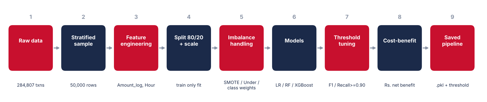
</p>

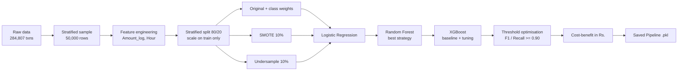

> [!IMPORTANT]
> The **test set is never resampled or modified**. SMOTE and undersampling touch the training data only, and the notebook proves it with a fingerprint check.

## 📂 Dataset
| Item | Detail |
|---|---|
| Source | [Kaggle: Credit Card Fraud Detection (mlg-ulb)](https://www.kaggle.com/datasets/mlg-ulb/creditcardfraud) |
| Rows | 284,807 transactions (a stratified **50,000-row** sample is used locally) |
| Features | 30: `V1`-`V28` (PCA-transformed), `Time`, `Amount` |
| Target | `Class` (1 = fraud, 0 = legitimate) |
| Imbalance | about **0.17%** fraud |

**Engineered features:** `Amount_log = log1p(Amount)` to tame the right skew and `Hour = (Time % 86400) // 3600` for time of day. The original `Time` and `Amount` columns are dropped, and only `Amount_log` and `Hour` are standard-scaled because V1-V28 are already PCA-scaled.

## 🔍 Exploratory data analysis
<p align="center">
  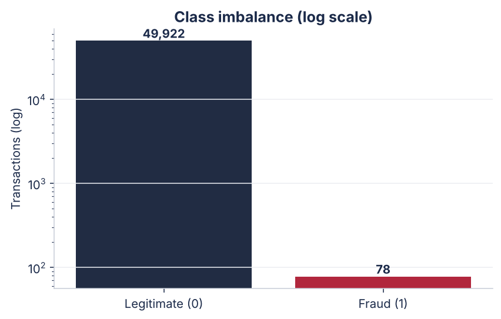
  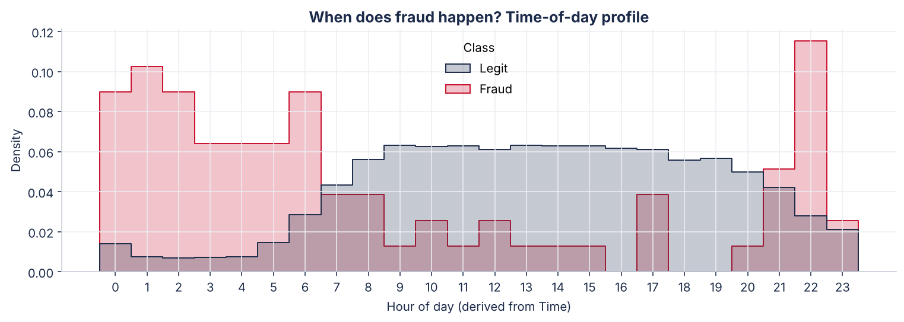
</p>
<p align="center">
  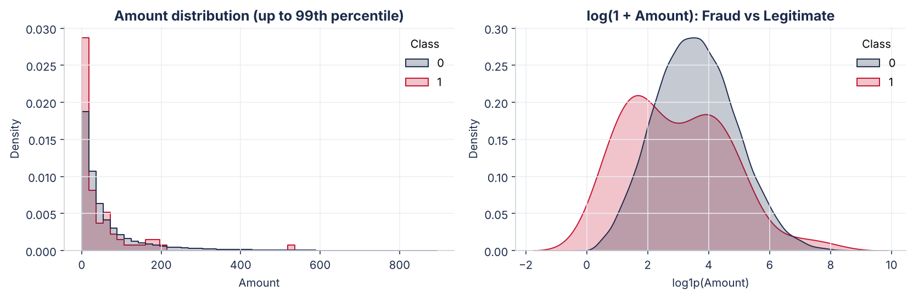
</p>
<p align="center">
  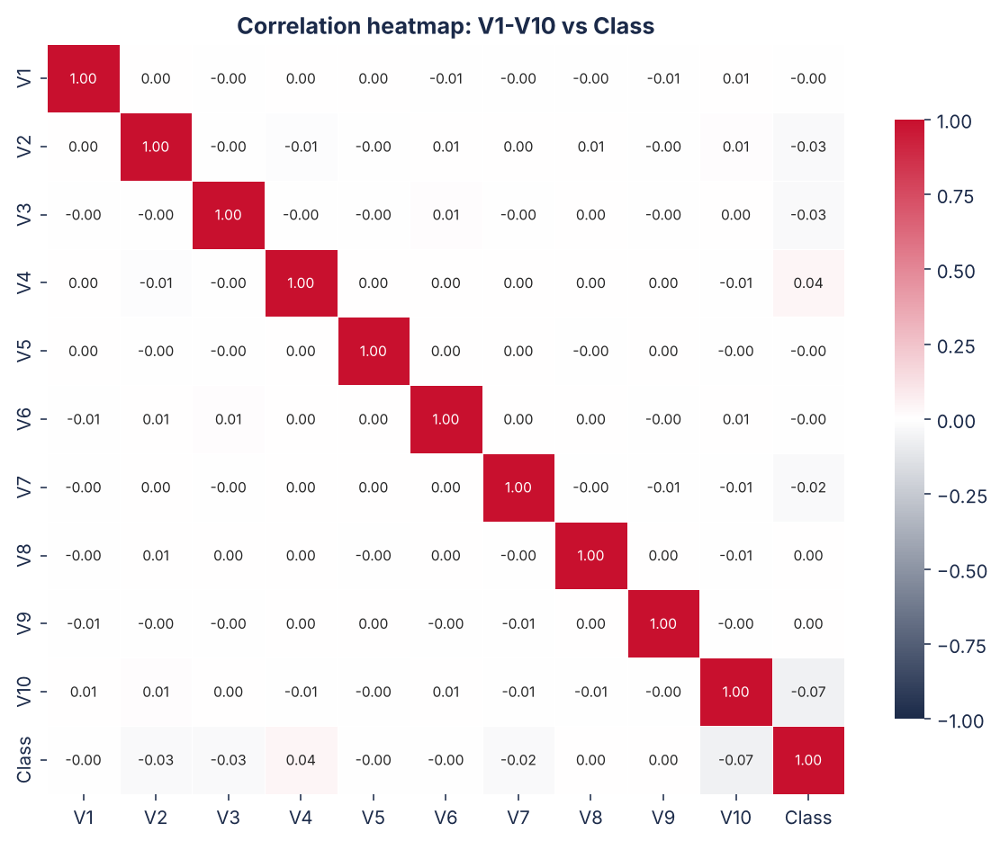
</p>

- **Amount:** median fraud amount is Rs.15.80 vs Rs.33.05 for legitimate transactions.
- **Time:** 47% of fraud happens between 00:00 and 05:59 against 6% of legitimate traffic.

## ⚖️ Handling the imbalance
| Strategy | What it does | Pros | Cons |
|---|---|---|---|
| **Class weights** | Fraud errors count more in the loss | No data change, no leakage | Adds no new information |
| **SMOTE** (fraud to 10% of legit) | Synthesises new fraud points | Keeps all data | Synthetic points can be unrealistic |
| **Random undersampling** (10%) | Drops legitimate rows | Fast, focuses on fraud | Throws away information |

Best strategy for Logistic Regression (by PR-AUC): **SMOTE**.

## 🤖 Models and results
**Logistic Regression: three variants**

| Variant | Precision | Recall | F1 | PR-AUC |
|---|:---:|:---:|:---:|:---:|
| LR | Original | 0.200 | 0.938 | 0.330 | 0.835 |
| LR | SMOTE | 0.389 | 0.875 | 0.538 | 0.862 |
| LR | Undersampled | 0.250 | 0.938 | 0.395 | 0.807 |

**Random Forest** used the **SMOTE** training set with `class_weight='balanced'`. **XGBoost** used `scale_pos_weight = 644.2`, then `RandomizedSearchCV` (15 iterations, 3-fold CV, scoring on average precision). Best parameters: `{'subsample': 0.8, 'n_estimators': 300, 'max_depth': 4, 'learning_rate': 0.1, 'colsample_bytree': 0.8}`, best CV PR-AUC **0.782**.

<p align="center">
  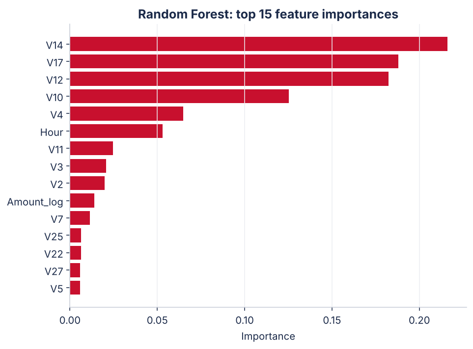
</p>

**Final comparison (test set)**

| Model | Precision | Recall | F1 | PR-AUC | Threshold |
|---|:---:|:---:|:---:|:---:|:---:|
| Logistic Regression (SMOTE, default) | 0.389 | 0.875 | 0.538 | 0.862 | 0.5000 |
| Random Forest (default) | 0.400 | 0.125 | 0.190 | 0.381 | 0.5000 |
| XGBoost Baseline (default) | 0.900 | 0.562 | 0.692 | 0.717 | 0.5000 |
| XGBoost Tuned (default 0.5) | 0.750 | 0.562 | 0.643 | 0.726 | 0.5000 |
| XGBoost Tuned (F1-optimal) | 1.000 | 0.562 | 0.720 | 0.726 | 0.8846 |
| XGBoost Tuned (Recall >= 0.90) | 0.065 | 0.938 | 0.121 | 0.726 | 0.0001 |

<p align="center">
  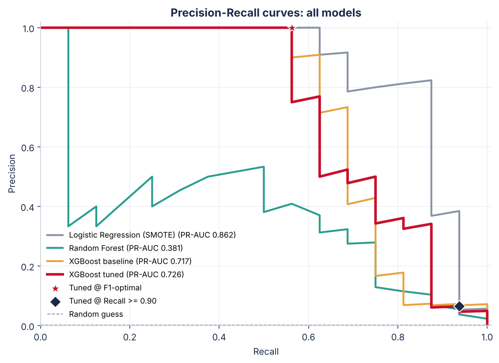
</p>

## 🎚️ Threshold optimisation
The default cut-off of 0.5 is rarely optimal for fraud. On the tuned XGBoost:

| Policy | Threshold | Precision | Recall |
|---|:---:|:---:|:---:|
| Default | 0.5000 | 0.750 | 0.562 |
| **F1-optimal** | **0.8846** | 1.000 | 0.562 |
| Recall >= 0.90 | 0.0001 | 0.065 | 0.938 |

<p align="center">
  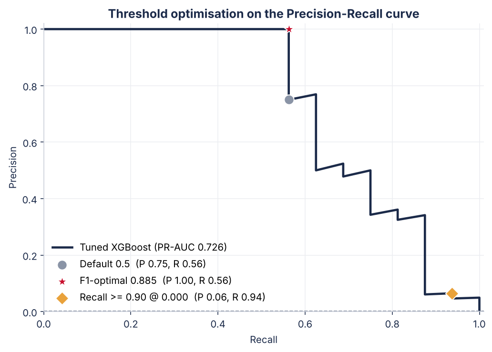
</p>

> [!TIP]
> In production the threshold is a **business decision**, not a model decision. A risk officer may demand Recall >= 0.95 even at the cost of more false alarms. The curves above show exactly what that trade-off looks like.

## 💰 Business impact (cost-benefit)
Assumptions: average fraud value **Rs.4,500**, cost to investigate one flagged transaction **Rs.150**.

- Money saved = TP x Rs.4,500
- Investigation cost = (TP + FP) x Rs.150
- Money lost = FN x Rs.4,500
- **Net benefit = Money saved - Investigation cost**

| Threshold | TP | FP | FN | Money saved | Investigation cost | Money lost | **Net benefit** |
|:---:|:---:|:---:|:---:|---:|---:|---:|---:|
| 0.1000 | 10 | 6 | 6 | Rs.45,000 | Rs.2,400 | Rs.27,000 | **Rs.42,600** |
| 0.2000 | 10 | 4 | 6 | Rs.45,000 | Rs.2,100 | Rs.27,000 | **Rs.42,900** |
| 0.3000 | 10 | 3 | 6 | Rs.45,000 | Rs.1,950 | Rs.27,000 | **Rs.43,050** |
| 0.5000 | 9 | 3 | 7 | Rs.40,500 | Rs.1,800 | Rs.31,500 | **Rs.38,700** |
| 0.8846 (F1-optimal) | 8 | 0 | 8 | Rs.36,000 | Rs.1,200 | Rs.36,000 | **Rs.34,800** |

At the F1-optimal threshold the net benefit is **Rs.39,150** on 10,000 test transactions, about **Rs.195,750 per 50,000 transactions**.

<p align="center">
  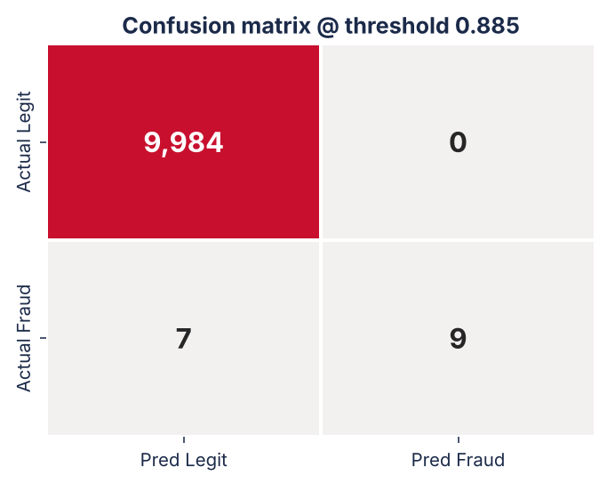
  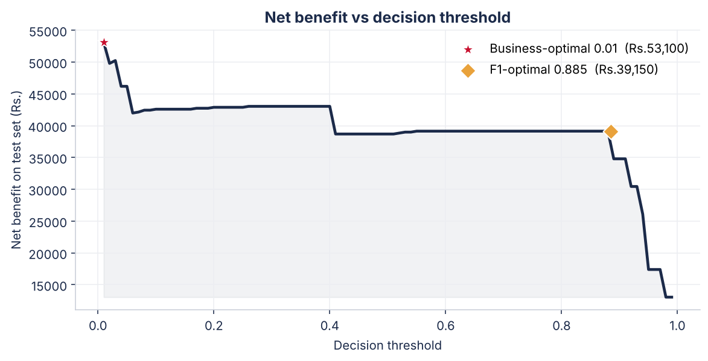
</p>

## 💡 Key learnings
1. **Accuracy is a trap** on imbalanced data. Judge models by PR-AUC, precision and recall.
2. **Resample training data only.** Touching the test set inflates results.
3. **The threshold is a lever.** Moving it changes the precision/recall balance far more than most hyper-parameter tuning.
4. **ML metrics and business metrics can diverge.** The F1-optimal threshold is not always the most profitable one.
5. **Ship the threshold with the model** so deployment never silently falls back to 0.5.

## 🗂️ Repository structure
```text
credit-fraud-detection-supervised-learning/
├── FraudDetection_SupervisedLearning.ipynb   # fully executed notebook (Steps 1-8)
├── fraud_detection_model.pkl                 # scikit-learn Pipeline (scaler + tuned XGBoost)
├── summary_report.md                         # ~1-page summary
├── results.json                              # machine-readable results
├── requirements.txt                          # dependencies
├── README.md                                 # you are here
└── images/                                   # figures used in this README
```

## 🚀 Quick start
```bash
# 1. clone
git clone https://github.com/YOUR-USERNAME/credit-fraud-detection-supervised-learning.git
cd credit-fraud-detection-supervised-learning

# 2. install
pip install -r requirements.txt

# 3. get the data: download creditcard.csv from Kaggle and place it in this folder
#    https://www.kaggle.com/datasets/mlg-ulb/creditcardfraud

# 4. run everything (re-creates the model, images and reports)
jupyter nbconvert --to notebook --execute --inplace FraudDetection_SupervisedLearning.ipynb
```

## 🧰 Using the saved model
```python
import joblib

model = joblib.load("fraud_detection_model.pkl")

# X needs: V1..V28, Amount_log (= np.log1p(Amount)), Hour (= (Time % 86400) // 3600)
proba = model.predict_proba(X[model.feature_names_])[:, 1]
is_fraud = proba >= model.optimal_threshold_      # tuned threshold travels with the model
```


---
