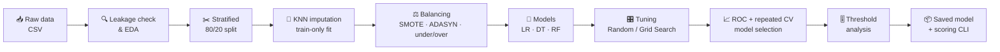
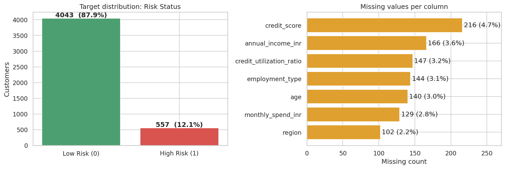
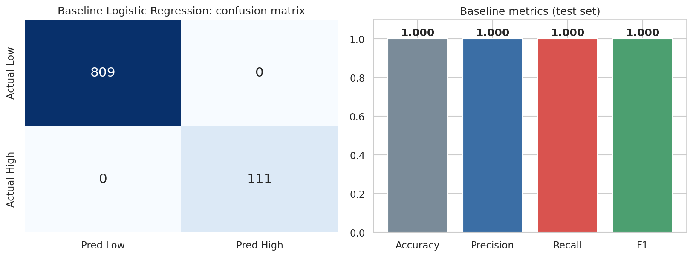
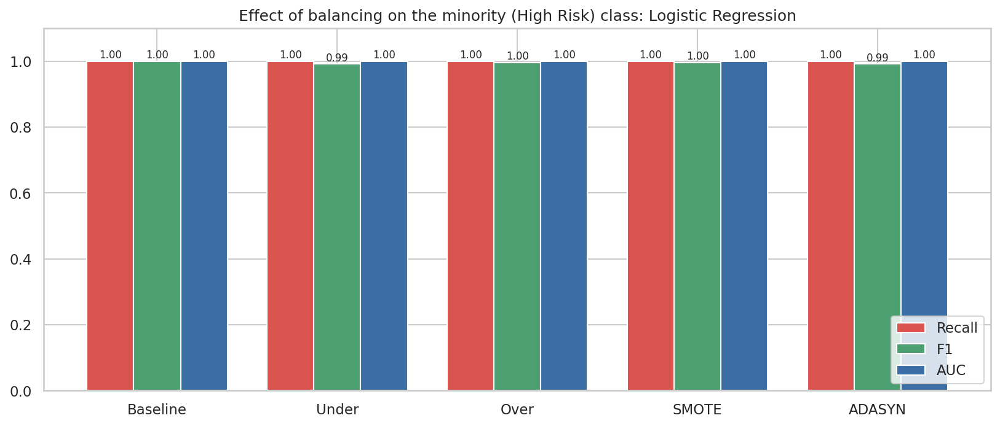
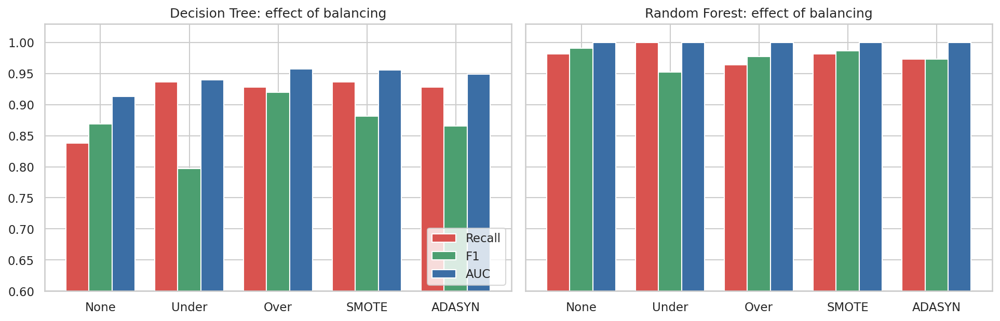
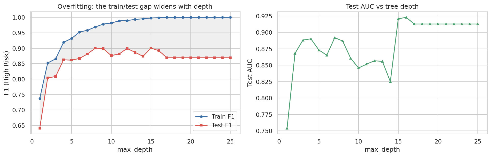
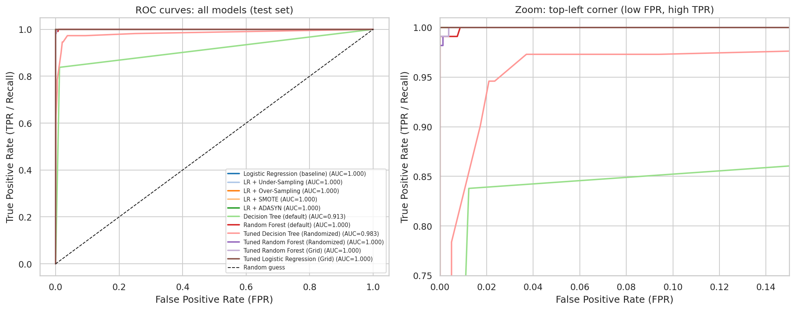
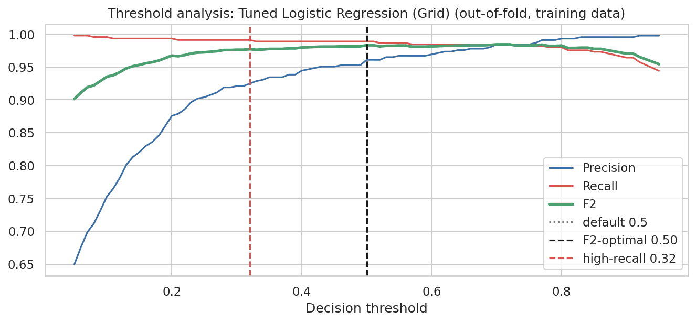
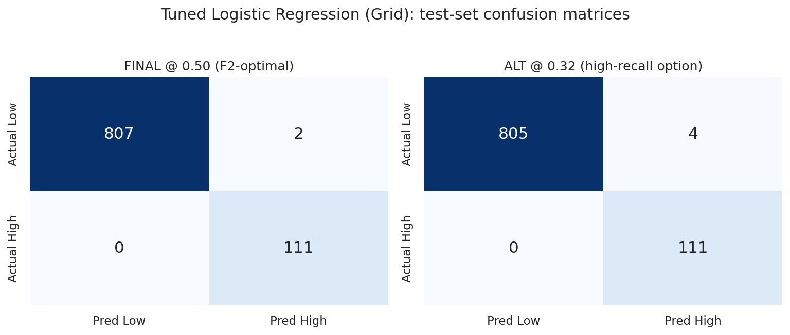
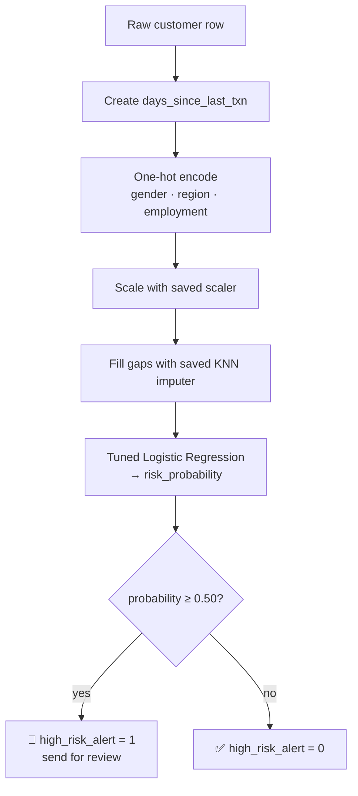

<div align="center">

# 🛡️ Risk Alert Classifier

### *Catch the high-risk customers before they become losses.*

An end-to-end machine-learning study that predicts whether a bank customer is
**High Risk (1)** or **Low Risk (0)**, built around class imbalance, tree-based models,
hyperparameter tuning and ROC-driven model selection.

<br>


[Overview](#-overview) •
[Results](#-headline-results) •
[Pipeline](#-pipeline-at-a-glance) •
[Findings](#-key-findings) •
[Concepts](#-concepts-explained-simple-language) •
[How the Code Works](#%EF%B8%8F-how-the-code-works-step-by-step) •
[Gallery](#-visual-gallery) •
[Quick Start](#-quick-start) •
[Scoring](#-score-new-customers) •
[Structure](#-repository-structure)

</div>

---

## 📖 Overview

Banks cannot review every customer, so an alert system has to decide **who gets a second look**.
This project builds that system as a binary classifier using demographic, transaction-activity and
credit-behaviour data, and studies every decision along the way: the split, the imputation, the
imbalance handling, the model family, the tuning metric and the final threshold.

> [!IMPORTANT]
> **Business goal — catch as many truly high-risk customers as possible.**
> A missed high-risk customer (*false negative, Type-II error*) costs far more than an unnecessary
> review (*false positive, Type-I error*). The final model is therefore chosen to **minimise false
> negatives** while keeping precision workable.

### ✨ What makes this project different

| | |
|---|---|
| ⚖️ **Imbalance-aware** | Only 12.1% of customers are high risk. Accuracy is rejected as a metric from the start. |
| 🔒 **Leakage-safe** | Split first. Scaler, KNN imputer and resamplers are fitted on training data only. |
| 🧪 **Thoroughly compared** | Logistic Regression, Decision Tree and Random Forest, with and without resampling and tuning. |
| 📈 **ROC-based selection** | Repeated 5x2 cross-validation with a precision floor, then a threshold check. |
| 🚀 **Deployable** | Saved model bundle and a CLI that scores raw customer rows. |
| 📚 **Documented** | Executed notebook, theory PDF and final report PDF. |

---

## 🏆 Headline Results

<div align="center">

| | |
|:---|:---|
| 🥇 **Final model** | Tuned **Logistic Regression** (L1, `C=0.3`, `class_weight='balanced'`, threshold `0.50`) |
| 🧾 **Test set** | 920 customers, 111 high risk |
| ✅ **Errors** | **0 false negatives**, 2 false positives |
| 🎯 **Test metrics** | Recall **1.000** · Precision **0.982** · F1 **0.991** · AUC **1.000** |
| 🔁 **Repeated 5x2 CV** | Recall 0.988 ± 0.012 · Precision 0.961 · AUC 0.9995 |
| 🚫 **Why not accuracy?** | Always predicting "Low Risk" scores **87.9% accuracy with 0% recall** |

</div>

> [!WARNING]
> **A note on the near-perfect scores.** No feature leaks the label, but the data behaves as if it
> were synthetic and almost linearly separable. Expect lower performance on real-world data
> (see *Limitations* in the final report).

---

## 🧭 Pipeline at a Glance



---

## 🗺️ Task Coverage

The notebook is organised into **Parts A to H** covering **27 tasks**.

| Part | Tasks | Theme | What the notebook contains |
|:---:|:---:|---|---|
| **A** | 1-6 | 📘 Theory | Short answers on Logistic Regression, metrics, Type-I/II errors, AUC-ROC and imbalance. Longer definitions in `docs/Theory_Concepts.pdf` |
| **B** | 7-9 | 🧹 Data prep | Feature/target identification, leakage check, stratified 80/20 split, missing-value analysis, KNN imputation fitted on train only |
| **C** | 10-12 | 🧱 Baseline | Logistic Regression baseline, confusion matrix, metrics, Type-I vs Type-II errors |
| **D** | 13-15 | ⚖️ Imbalance | Impact of imbalance, under-sampling, over-sampling, SMOTE, ADASYN, before/after comparison (recall, F1, AUC), plus tree-model and severe-imbalance experiments |
| **E** | 16-19 | 🌳 Trees | Decision Tree, overfitting analysis (depth curve), Random Forest, comparison |
| **F** | 20-22 | 🎛️ Tuning | Randomized Search CV (DT, RF), Grid Search CV (RF, LR), tuned vs untuned |
| **G** | 23-25 | 📈 Selection | ROC curves, AUC table, repeated-CV selection with a precision floor, threshold analysis |
| **H** | 26-27 | 📝 Reporting | Final report (notebook and PDF), cost illustration, saved model and scoring function |

---

## 🔬 Key Findings

<details open>
<summary><b>1️⃣ Imbalance makes accuracy useless</b></summary>

<br>

With only **12.1% High Risk**, the majority-class dummy model reaches **87.9% accuracy and 0% recall**.
Recall, F1 and AUC are the metrics that matter here.

</details>

<details open>
<summary><b>2️⃣ Logistic Regression is the best model on this data</b></summary>

<br>

The risk label is close to a weighted combination of about nine credit-behaviour features, so linear
models are near-perfect while a single tree overfits (**train F1 1.000 vs test 0.869**).

</details>

<details open>
<summary><b>3️⃣ Resampling helps where the model is weak</b></summary>

<br>

| Scenario | Effect |
|---|---|
| Decision Tree recall | 0.838 → **0.93** with resampling |
| Random Forest at severe imbalance (1.8%) | Recall falls to **0.793** |
| …with SMOTE / ADASYN | Recovers to **0.856** |
| …with under-sampling | Reaches **1.000**, at the cost of 13 false positives |
| …with plain over-sampling | Gets worse (**0.712**) |
| Logistic Regression | No gain, since recall was already 1.000 |

</details>

<details open>
<summary><b>4️⃣ Tuning with an F2 score matches the business need</b></summary>

<br>

F2 weights recall more heavily than precision, trading a few false positives for fewer misses.

</details>

<details open>
<summary><b>5️⃣ Top risk drivers</b></summary>

<br>

⏱️ Late-payment days &nbsp;·&nbsp; ❌ Missed payments &nbsp;·&nbsp; 💳 Credit utilisation &nbsp;·&nbsp;
🏦 Debt balance &nbsp;·&nbsp; 💰 Low income &nbsp;·&nbsp; 📉 Low credit score

</details>

---

## 🖼️ Visual Gallery

<div align="center">

### 🎯 Data & Baseline

| Target distribution & missing values | Baseline confusion matrix |
|:---:|:---:|
|  |  |

### ⚖️ Handling Imbalance

| Balancing with Logistic Regression | Balancing with tree models |
|:---:|:---:|
|  |  |

### 🌳 Overfitting & Model Selection

| Decision Tree overfitting curve | ROC curves, all models |
|:---:|:---:|
|  |  |

### 🏁 Final Model

| Threshold analysis | Final confusion matrix |
|:---:|:---:|
|  |  |

</div>

---

## 🚀 Quick Start

### 1. Clone and set up

```bash
python -m venv .venv && source .venv/bin/activate      # optional but recommended
pip install -r requirements.txt
```

### 2. Run the notebook

```bash
jupyter notebook Risk_Alert_Classifier.ipynb            # Kernel -> Restart & Run All
```

> ⏱️ Runs top to bottom in roughly **6-8 minutes on one CPU**. Most of the time goes to the Random Forest searches.

### 3. (Optional) Rebuild the notebook and PDFs from source

```bash
python src/run_notebook.py && PYTHONPATH=src python src/make_final_report.py
```

### 📦 Dependencies

| Package | Purpose |
|---|---|
| `numpy`, `pandas` | Data handling |
| `scikit-learn` | Models, tuning, metrics |
| `imbalanced-learn` | SMOTE, ADASYN, under/over-sampling |
| `matplotlib`, `seaborn` | Visualisation |
| `joblib` | Saving the model bundle |
| `jupyter` | Running the notebook |
| `reportlab` | *Only* needed to regenerate the PDFs in `docs/` |

---

## 🔮 Score New Customers

```bash
python src/score_new_customers.py path/to/customers.csv scored.csv
```

The script loads `models/risk_alert_model.joblib` (model, scaler, KNN imputer and threshold) and applies
the **identical** feature engineering, encoding and imputation to raw rows that use the original CSV columns.

| Output column | Meaning |
|---|---|
| `risk_probability` | Model probability that the customer is high risk |
| `high_risk_alert` | `1` = send for review, `0` = no alert |

---

## 🗂️ Repository Structure

```text
risk-alert-classifier/
├── 📓 Risk_Alert_Classifier.ipynb     # Main notebook: Parts A-H, executed, with outputs and interpretations
├── 📊 data/
│   └── risk_alert_classifier_dataset.csv
├── 🖼️ figures/                         # Every chart from the notebook (PNG)
├── 📸 screenshots/                     # Key figures used in this README
├── 📈 results/                         # Leaderboard, CV comparison, final metrics (CSV)
├── 🤖 models/
│   └── risk_alert_model.joblib        # Final model + preprocessing + threshold
├── 📚 docs/
│   ├── Theory_Concepts.pdf            # Definitions of all theory concepts (Part A and more)
│   └── Final_Report.pdf               # Part H report
├── 🧰 src/
│   ├── nb_cells.py, interp.py, run_notebook.py      # Build and execute the notebook
│   ├── score_new_customers.py                       # CLI scoring of raw customer rows
│   └── make_theory_pdf.py, make_final_report.py, pdf_common.py
├── 📋 requirements.txt
└── 📖 README.md
```

---

## 🧠 Concepts Explained (Simple Language)

Every idea used in this project, in plain words, with *why it is needed here*.

### 1. Classification and Logistic Regression

Classification means predicting a **category** (here: Low Risk or High Risk). **Logistic Regression** does it in two steps:

1. Combine the features into one score: `z = b0 + b1·x1 + b2·x2 + ... + bk·xk`
2. Squash the score into a probability between 0 and 1 with the **sigmoid**: `p = 1 / (1 + e^(-z))`

If `p ≥ threshold` (usually 0.5) the customer is flagged **High Risk**. It is a good fit because it gives probabilities,
trains fast, and each coefficient is easy to read (`exp(b)` is the *odds ratio*: how much the odds of high risk change per unit of that feature).

### 2. Confusion matrix, Type-I and Type-II errors

|  | Predicted Low | Predicted High |
|---|:---:|:---:|
| **Actually Low** | ✅ TN | ⚠️ **FP** (Type-I) |
| **Actually High** | ❌ **FN** (Type-II) | ✅ TP |

* **Type-I error (False Positive):** a safe customer is flagged. *Cost: wasted review, annoyed customer.*
* **Type-II error (False Negative):** a risky customer is missed. *Cost: undetected default or fraud.* **This is the expensive one.**

### 3. Metrics

| Metric | Formula | Plain meaning |
|---|---|---|
| Accuracy | (TP+TN) / total | Share of all predictions that were right. **Misleading** when classes are imbalanced |
| Precision | TP / (TP+FP) | Of everyone we flagged, how many were really high risk |
| Recall (= TPR) | TP / (TP+FN) | Of all real high-risk customers, how many we caught |
| F1 | 2·P·R / (P+R) | Balance of precision and recall |
| **F2** | recall counts 2x more than precision | Used in tuning because **misses are costlier** than false alarms |
| FPR | FP / (FP+TN) | Share of safe customers wrongly flagged |

### 4. Why accuracy fails here (class imbalance)

Only **12.1%** of customers are High Risk (557 vs 4,043, about 7.3 : 1). A "model" that always says *Low Risk* gets **87.9% accuracy
and 0% recall**, so it looks great while catching nobody. That is why this project judges models by **recall, F1/F2 and AUC**.

### 5. Data leakage and how it is avoided

*Leakage* means the model accidentally sees information it would not have in real life, giving fake-good scores.
Three protections are used:

* `customer_id` is dropped (pure identifier).
* **Single-feature AUC check:** each feature is scored alone. If one were near 1.0 it might be leaking the label. The highest is `avg_late_payment_days` at 0.953, so no leak.
* **Split first.** The train/test split happens *before* imputation, scaling and resampling, and every one of those is fitted on the **training data only**.

### 6. Stratified train/test split

`train_test_split(test_size=0.20, stratify=y)` keeps the same High-Risk share (12.1%) in both train and test.
Without stratification the test set could end up with too few high-risk customers to judge anything.

### 7. Missing values and KNN imputation

Seven columns have missing values (2.2% to 4.7% of rows). Instead of deleting rows or filling with a simple mean, **KNN imputation**
looks at the 5 most *similar* customers (using all the other features) and estimates the missing value from them.

Why this needs care:
* KNN is **distance-based**, so features are **standardised first** (otherwise income in rupees would swamp ratios between 0 and 1).
* Categories (gender, region, employment type) are **one-hot encoded** first. A missing category becomes `NaN` in all its dummy columns so it can be imputed too; afterwards the largest dummy wins.
* Age and credit score are rounded back to whole numbers, and utilisation is clipped to 0-1.

### 8. Feature scaling

`StandardScaler` rescales each feature to mean 0 and standard deviation 1. It matters for **Logistic Regression, KNN, SMOTE and ADASYN**
(distance/gradient based). **Trees do not need it** (splits are unaffected), so trees use the unscaled imputed data.

### 9. Resampling techniques (fixing imbalance)

All four are applied to the **training set only**; the test set is never touched.

| Technique | How it works | Trade-off |
|---|---|---|
| **Random Under-Sampling** | Throws away majority rows until classes are 1:1 | Fast, but loses information and adds false positives |
| **Random Over-Sampling** | Duplicates minority rows until 1:1 | Can overfit to repeated points |
| **SMOTE** | Creates *new* synthetic minority rows by interpolating between a minority point and one of its `k` nearest minority neighbours | Smoother than duplicating |
| **ADASYN** | Like SMOTE, but generates **more** points where the minority is harder to learn | Focuses on difficult regions |

Alternative: `class_weight='balanced'` makes mistakes on the rare class cost more, with no resampling needed. It is included in the tuning search.

### 10. Decision Tree and overfitting

A **Decision Tree** asks a chain of yes/no questions ("is late-payment days > 9?") until it reaches a verdict.
Left unlimited, it **memorises** the training data: here the full tree (depth 17, 74 leaves) scores F1 **1.000 on train but 0.869 on test**.
That gap is **overfitting**. The depth curve (depth 1 to 25) shows test F1 peaking near depth 8, then stalling.
Fixes: limit `max_depth`, raise `min_samples_leaf`, or prune with `ccp_alpha`.

### 11. Random Forest

A **Random Forest** trains many (100+) trees on random subsets of rows and features, then lets them **vote**.
Averaging de-correlated trees cancels out each tree's mistakes, so the train/test F1 gap shrinks from **0.131 (single tree) to 0.009**.

### 12. Hyperparameter tuning

*Hyperparameters* are settings you choose before training (tree depth, number of trees, regularisation strength `C`...).

* **Randomized Search CV:** tries a random sample of combinations from a wide space. Cheap way to *explore*.
* **Grid Search CV:** tries *every* combination in a small grid around the best random result. Used to *refine*.
* Both use **5-fold stratified cross-validation on the training set only**, scored with **F2** so recall matters most.

### 13. Regularisation (L1 vs L2)

In Logistic Regression, `C` controls how strongly large coefficients are penalised (smaller `C` = stronger penalty). **L1** can shrink useless
coefficients all the way to zero (built-in feature selection); **L2** shrinks them smoothly. The winner was **L1 with `C=0.3`**.

### 14. ROC curve and AUC

A **ROC curve** plots TPR (recall) against FPR as the decision threshold sweeps from 0 to 1. **AUC** is the area under it:
1.0 = perfect ranking, 0.5 = coin flip. It measures how well the model *ranks* risky customers above safe ones, independent of any threshold.
Because many models hit AUC ≈ 1.0 here, AUC alone cannot pick the winner, so repeated CV is used as well.

### 15. Repeated stratified CV and the selection rule

One test set has only **111 positives**, so one or two errors swing recall by 1-2 points. To avoid choosing on noise, candidates are compared with
**repeated stratified 5-fold CV (x2)** on the training set, and the rule is explicit:

> **Highest CV recall among models with CV precision ≥ 0.95.**

The precision floor knocks out models that "win" recall by flagging everyone (both Decision Trees fail it: 0.885 and 0.755).

### 16. Threshold tuning

The default cut-off of 0.5 is not sacred. Using **out-of-fold predictions on the training set** (`cross_val_predict`), thresholds from 0.05 to 0.95
are scanned to maximise F2. For the final model the best is **0.50**, because `class_weight='balanced'` already shifted probabilities toward high risk.
A lower cut-off (0.32) is kept as a *high-recall option*. The test set plays **no role** in choosing it.

### 17. Business cost view

Assuming a miss costs **10x** a false alarm (an illustrative assumption, replace with real figures):
`relative cost = FN × 10 + FP × 1`. This turns model quality into one comparable number.

---

## ⚙️ How the Code Works (Step by Step)

The notebook runs top to bottom. Below is what each stage does, with the key code.

### Stage 0 · Setup
Imports pandas, NumPy, seaborn, scikit-learn; sets `RANDOM_STATE = 42` for reproducibility; defines `save_fig()` which writes every chart to `figures/`.

### Stage 1 · Load and explore
```python
df = pd.read_csv("data/risk_alert_classifier_dataset.csv")
```
Plots the target balance (4,043 Low vs 557 High) and missing values per column, then box-plots key features by class. High-risk customers show
more late-payment days (mean 16.3 vs 4.1), more missed payments (3.3 vs 0.6), higher utilisation (0.67 vs 0.36) and lower credit score (589 vs 690).

### Stage 2 · Feature engineering and target
```python
ref_date = pd.to_datetime(df["last_transaction_date"]).max() + pd.Timedelta(days=1)
df["days_since_last_txn"] = (ref_date - pd.to_datetime(df["last_transaction_date"])).dt.days
X = df.drop(columns=["customer_id", "last_transaction_date", "risk_status"])
y = df["risk_status"]
```
* The raw date becomes a useful number: **days since last transaction** (recency).
* `customer_id` is dropped. Target = `risk_status`.
* Features are grouped as **Demographic**, **Credit behaviour** and **Transaction / activity**.

### Stage 3 · Leakage check
```python
a = roc_auc_score(y[ok], X.loc[ok, c])      # for each numeric feature
single_feature_auc = max(a, 1 - a)
```
Scores every numeric feature on its own. No feature reveals the label.

### Stage 4 · Stratified split
```python
X_train, X_test, y_train, y_test = train_test_split(
    X, y, test_size=0.20, stratify=y, random_state=42)
```

### Stage 5 · Encoding + KNN imputation (train-only fit)
```python
Xtr_enc = one_hot_with_nan(X_train)
Xte_enc = one_hot_with_nan(X_test, columns=Xtr_enc.columns)   # same columns as train

scaler_imp  = StandardScaler().fit(Xtr_enc)                    # fitted on train only
knn_imputer = KNNImputer(n_neighbors=5).fit(scaler_imp.transform(Xtr_enc))
```
`impute()` then: scale → KNN fill → inverse-scale → snap one-hot groups back to valid rows → round integers → clip ratios.
Result: **0 missing values** in both sets and a **27-column numeric matrix**. A KDE sanity plot confirms distributions barely change
(mean credit score 677.6 → 677.7).

### Stage 6 · Scaled copies and shared helpers
```python
scaler = StandardScaler().fit(X_train_imp)
X_train_s, X_test_s = scaler.transform(X_train_imp), scaler.transform(X_test_imp)
```
* Scaled data → Logistic Regression, SMOTE, ADASYN.
* Unscaled imputed data → tree models.
* `evaluate(name, y_true, y_pred, y_prob)` computes accuracy, precision, recall, F1, F2, AUC, TN/FP/FN/TP and stores each model's row in `RESULTS` and its probabilities in `PROBS`, so every later comparison and the ROC plot reuse the same numbers.

### Stage 7 · Baseline Logistic Regression (Part C)
```python
lr = LogisticRegression(max_iter=1000, random_state=42).fit(X_train_s, y_train_arr)
```
Default settings, no balancing. Result on 920 test rows: **809 TN, 0 FP, 0 FN, 111 TP**. A coefficient chart shows the drivers: income (negative);
late-payment days, utilisation, debt balance and missed payments (positive).

### Stage 8 · Imbalance study (Part D)
* `DummyClassifier(strategy="most_frequent")` proves accuracy is misleading (87.9% accuracy, 0% recall).
* A `samplers` dictionary holds **Under, Over, SMOTE, ADASYN**; each resamples the **training set only**, then a fresh Logistic Regression is trained and evaluated on the untouched test set.
* **Fallback design:** the code tries `from imblearn...`; if the library is missing it uses built-in versions of the same algorithms built on `sklearn.neighbors.NearestNeighbors`.
* **Extended experiment:** repeats everything for Decision Tree and Random Forest.
* **Stress test:** training set cut to about 60 high-risk rows (1.8%) to expose what imbalance really does to a flexible model.

### Stage 9 · Trees (Part E)
```python
dt = DecisionTreeClassifier(random_state=42).fit(X_train_imp, y_train_arr)
rf = RandomForestClassifier(n_estimators=100, random_state=42, n_jobs=-1).fit(X_train_imp, y_train_arr)
```
A loop trains trees of depth 1 to 25 to draw the **overfitting curve**; Random Forest feature importances show the main risk drivers; a train-vs-test table quantifies the generalisation gap.

### Stage 10 · Tuning (Part F)
```python
cv = StratifiedKFold(n_splits=5, shuffle=True, random_state=42)
f2_scorer = make_scorer(fbeta_score, beta=2)
```
* **RandomizedSearchCV** over wide spaces for Decision Tree (depth, split/leaf sizes, criterion, `class_weight`, `ccp_alpha`...) and Random Forest (trees, depth, leaf sizes, `max_features`, `class_weight`...).
* **GridSearchCV** refines Random Forest around the random-search winner.
* **GridSearchCV** on Logistic Regression: `C` ∈ {0.01 ... 100}, penalty ∈ {L1, L2}, `class_weight` ∈ {None, balanced} (solver `liblinear`).

### Stage 11 · ROC and model selection (Part G)
* Plots ROC curves of **all** models on one chart plus a zoomed panel, and an AUC bar chart.
* Builds a `Pipeline([StandardScaler, model])` per candidate and scores each with `RepeatedStratifiedKFold` and `cross_validate`.
* Applies the rule:
```python
eligible = cv_tbl[cv_tbl["CV Precision"] >= 0.95].sort_values(
    ["CV Recall", "CV F2", "CV AUC"], ascending=False)
FINAL_NAME = eligible.index[0]          # -> Tuned Logistic Regression (Grid)
```
* Threshold scan with `cross_val_predict(..., method="predict_proba")` on the training set, then the chosen threshold is applied **once** to the test set.

### Stage 12 · Report, cost and export (Part H)
* Cost table with `FN × 10 + FP × 1`.
* Leaderboard and comparisons are saved as CSV in `results/`.
* The whole chain is saved with joblib:
```python
bundle = {"model": final_est, "threshold": THRESH, "feature_columns": list(Xtr_enc.columns),
          "ref_date": ref_date, "scaler_imputer": scaler_imp, "knn_imputer": knn_imputer,
          "final_name": FINAL_NAME}
joblib.dump(bundle, "models/risk_alert_model.joblib")
```
A `score_customers()` function and `src/score_new_customers.py` reload this bundle and apply the same engineering → encoding → imputation → model → threshold chain to raw rows.

### 🔄 How a new customer gets scored



---

## 🧪 Methodology Notes

<details>
<summary><b>🔒 No leakage</b></summary>

<br>

The split is done **first**. The scaler, KNN imputer and resamplers are fitted on training data only, and
the test set is used **once**, for reporting.

</details>

<details>
<summary><b>🔁 Resampling backend</b></summary>

<br>

The notebook uses `imbalanced-learn` when installed, otherwise a built-in implementation of the same algorithms.
The committed outputs were generated with the built-in version because the library was not available in the
build environment. Re-running with the library may change numbers slightly.

</details>

<details>
<summary><b>🎯 Selection rule</b></summary>

<br>

Pick the model with the **highest repeated-CV recall among models with CV precision ≥ 0.95**, then run a
threshold check on out-of-fold predictions.

</details>

---

## ⚠️ Limitations

* The data appears synthetic and almost linearly separable, so real-world performance will likely be lower.
* A simple linear model winning here says more about the dataset than about linear models in general.
* Resampled results may differ slightly depending on the resampling backend (see above).

---

<div align="center">

### ⭐ If you found this project useful, consider giving it a star!

*Built with 🧠 scikit-learn, 📊 pandas and a healthy fear of false negatives.*

</div>
